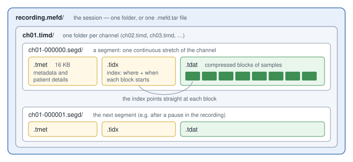
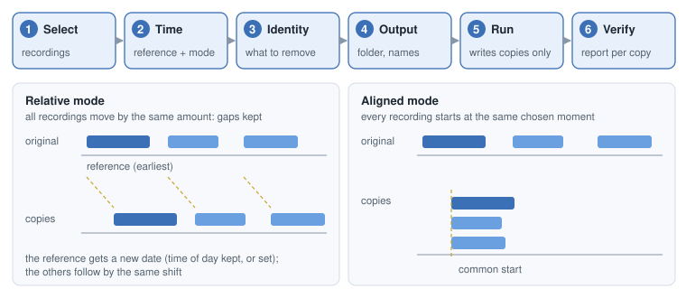
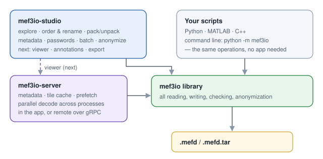

# mef3io-studio

**A desktop app for exploring, organizing, protecting and anonymizing MEF 3.0 recordings, with no programming needed.**

> **Status: planning.** Nothing to install yet. This repository currently holds
> the plan, the design and the open issues for the first release. Follow the
> [roadmap](docs/roadmap.md) or the [tracking issue](https://github.com/bnelair/mef3io-studio/issues/1).

mef3io-studio runs on **Windows, macOS and Linux**. It is built on
[mef3io](https://github.com/bnelair/mef3io), the library that reads and writes
MEF 3.0 files, so everything the app does to a file is done by the same
tested code that researchers use from Python and MATLAB.

---

## What is MEF 3.0, and why would I have it?

**MEF 3.0** (Multiscale Electrophysiology Format) is a file format for long
brain and body recordings: intracranial EEG, scalp EEG, ECG. Some of these
recordings run for days or months, across hundreds of channels. A single
recording can be **hundreds of gigabytes**.

MEF handles that by cutting each channel into small, compressed **blocks** and
keeping an **index** of where each block is and when it starts. A program can
jump straight to any moment in the recording and read only that part.

  

A recording (a **session**, the `.mefd` folder) contains one folder per
**channel** (`.timd`). Each channel is split into **segments** (`.segd`), and
each segment has three files:

| File | What it holds | Size |
|---|---|---|
| `.tmet` | metadata: sampling rate, units, and the patient details | always 16 KB |
| `.tidx` | the index: one entry per block (where it is, when it starts, its min/max) | small, ~2% of the data |
| `.tdat` | the compressed blocks of samples | most of the recording |

A session can also be packed into a single **`.mefd.tar`** file, which is
easier to copy and share. It is read directly; there's no need to unpack it.

## What the app will do

### First release

**1. Explore.** Open one or many recordings and see what's in them, without
loading any signal:
- channels, sampling rates and units;
- start and end time, duration, gaps;
- segments and annotations;
- whether the session is encrypted;
- which mef3io version wrote it (its provenance);
- an integrity check.

Patient details are **hidden by default**. Times can be shown in UTC, or in
the recording site's local time: you **choose the site's time zone** once
(the files can't tell the app reliably), and local times are then correct
across daylight-saving changes.

**2. Order and rename.** Got a folder of sessions whose names are long random
codes? See them sorted by when they were recorded, then rename them safely:
- **preview** every change first;
- name clashes are caught before anything happens;
- **undo** whole renames.

A session's name is stored in several places, including inside its files.
mef3io changes all of them together, so other MEF software still finds
everything, annotations included. For a password-protected recording the app
asks for the password first, because part of the name is stored in the locked
details; without it, the rename is not done.

**3. View and edit details.** See, and correct, the descriptive information
stored with a recording: subject, recording location, descriptions. Edit one
recording or many at once, with a preview and undo. **Recording times can
never be edited**; they only change through anonymization (below).

**4. Protect with passwords, or remove them.** Save a copy with new
passwords, or without any.
- In files written by common tools, MEF passwords lock the **patient
  details, settings and annotations**.
- **They don't hide the signal, the recording's name, or its timing.** Some
  files keep the true date hidden until the second, full-access password is given.
- The app explains this before you rely on it.

**5. Pick channels, and convert in batches.** Choose the channels you need,
save that choice, and apply it to many recordings at once. Combine it with
passwords and anonymization, in one pass per recording.

**6. Anonymize.** Make a **copy** of one or many recordings with the patient
details removed and every time shifted. The originals are not touched.

  

- **Pick a reference** recording (by default the earliest) and give it a new
  date, and optionally a new time of day.
- **Relative mode:** every other recording moves by the same amount, so they
  still follow each other exactly as before.
- **Aligned mode:** every recording starts at the same chosen moment.
- **Verified:** every copy is checked before it is kept. The samples must be
  exactly the same, every time must be shifted by exactly the chosen amount,
  and a scan confirms that no original date remains anywhere in the files. (The
  copy's time-zone and daylight-saving settings are not shifted: they are
  cleared, so the copy doesn't hint at where it was recorded.)

See the [anonymizer design](docs/design/anonymizer.md) for the details.

Everything that takes time (converting, anonymizing, checking big recordings)
runs in the background with a **progress bar** and a **cancel** button. The
app never freezes.

### Next directions (to be specified later)

- **Signal viewer:** scroll and zoom through the traces, with gaps and
  annotations shown, fast even on multi-TB recordings.
- **Data coverage:** see when data exists and at what rate, per channel. The
  fastest way to spot dropouts and gaps.
- **Annotations:** view, and later create and edit, events and notes.
- **Export** to other formats (e.g. EDF, NWB).
- **Remote recordings** kept on a secure server.

These need their own specifications before work starts; see
[next directions](docs/design/next-directions.md).

## How it fits together

  

**The app never edits MEF files itself.** Everything that touches a file is
done by the [mef3io](https://github.com/bnelair/mef3io) library, where it is
tested against the reference implementations. The same operations are also
available from Python, MATLAB and the command line, for batch work on servers.

The future viewer will use
[mef3io-server](https://github.com/bnelair/mef3io-server), which is built on
mef3io and keeps recently viewed data ready, so scrolling stays smooth. It
runs inside the app for files on your computer, or as a separate server for
recordings kept elsewhere.

## Privacy

- **Nothing leaves your computer.** The app makes no network connections.
- **Logs never contain** patient details, recording names or folder paths, or
  original recording dates.
- **Anonymizing, password changes and channel selections always write verified
  copies;** the originals are not touched. Renaming and editing details change
  a recording in place, only after you confirm, and can be undone unless you
  turn undo off.
- **Undo information** (old names, details before an edit, recording dates) is kept in the
  app's own data folder, never next to your recordings. You can review and
  delete it at any time.
- **Key file:** if you choose to save one (it maps the original recordings to
  their pseudonyms and time shifts), the app warns you that it re-identifies
  the data and must be stored separately.

## For developers

- [Vision and scope](docs/vision.md)
- [Architecture](docs/architecture.md)
- [Roadmap](docs/roadmap.md)
- Design notes: [explorer](docs/design/explorer.md) · [anonymizer](docs/design/anonymizer.md) · [next directions](docs/design/next-directions.md)
- [Contributing](CONTRIBUTING.md)

The library side of the plan is tracked in
[mef3io#71](https://github.com/bnelair/mef3io/issues/71).

## License

[Apache 2.0](LICENSE). Developed at the Mayo Clinic Bioelectronics
Neurophysiology and Engineering Lab (BNEL).
