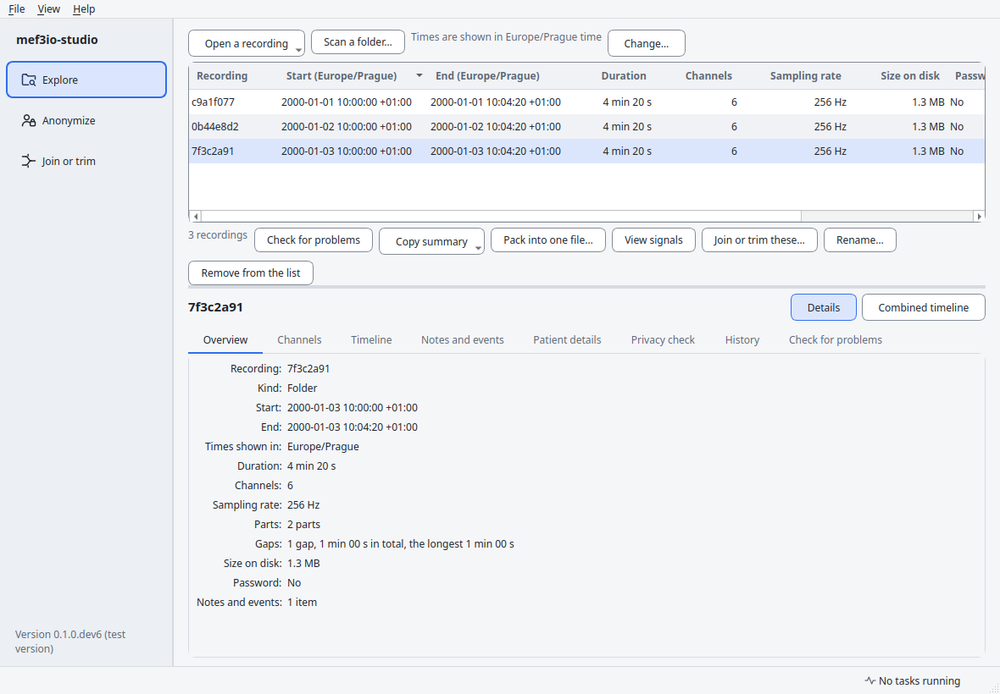
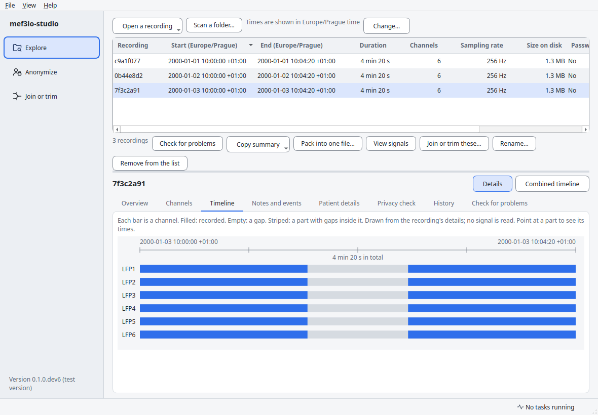
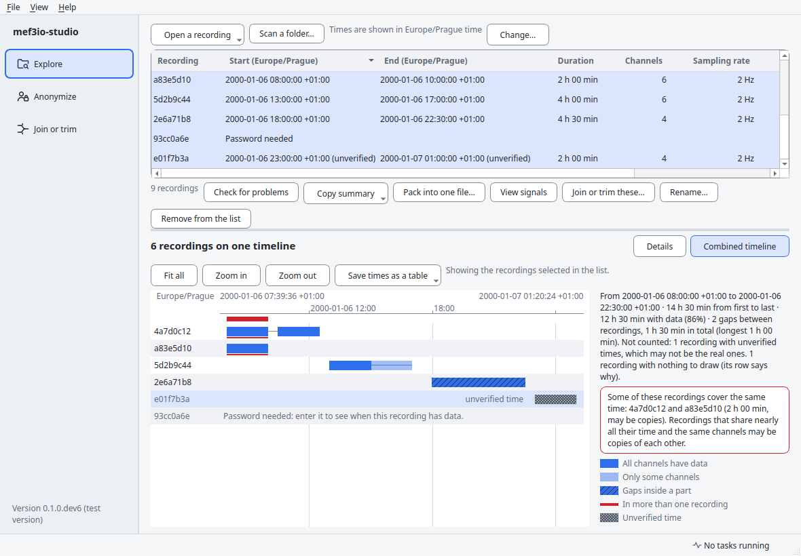
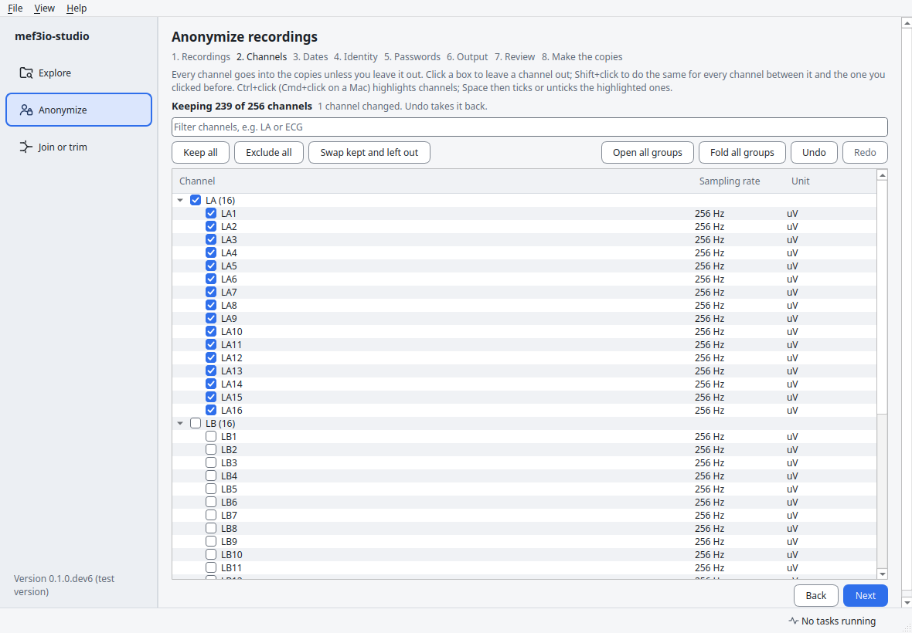
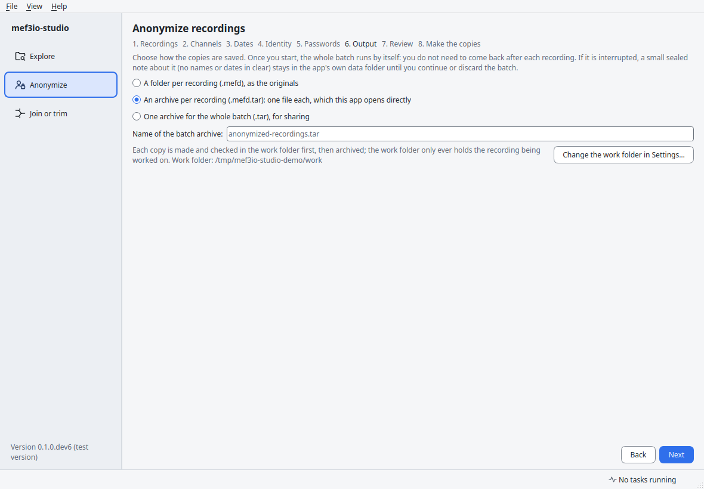
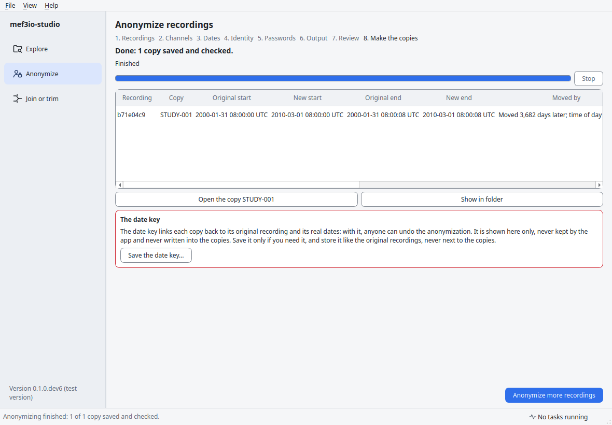
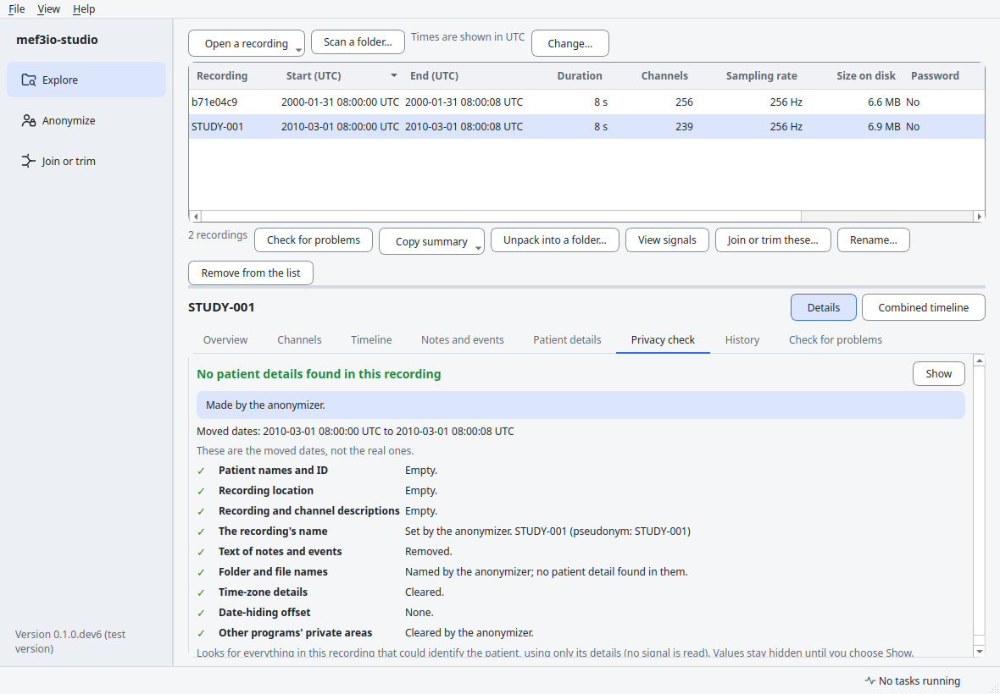

# User guide

This guide describes the app as of version **0.1.5**. It has three pages:
**Explore** (see what is in your recordings), **Anonymize** (make
anonymized copies of them) and **Join or trim** (keep part of a recording,
or join parts of several into one). From Explore you can also rename
recordings, edit their details into a new copy, make new recordings from
many at once, and open the **signal viewer** to look at the traces, where an
optional edit mode adds notes and events. What is new in each version is in
the [release notes](release-notes/).

Times are shown in **UTC** until you choose a time zone (see *Times and time
zones*). The app never changes your original recordings: anonymizing, joining,
trimming, editing details and making new recordings make a new recording and
check it, and the viewer only looks. The exceptions are renaming (see
*Rename recordings*) and edit mode, which can add notes and events to a
recording after you confirm (see *Add notes and events*).

## Explore recordings

The **Explore** page shows what is in your recordings: channels, when they
start and end, gaps, notes and events, and more. **Opening a recording never
changes it, and its signal is not loaded**, so even very large recordings
open quickly.

### Opening recordings

A recording is a folder ending in `.mefd`, or a single file ending in
`.mefd.tar`. There are three ways to open one:

- **Open a recording** (top left, or File → Open): pick a recording folder or
  a single-file recording.
- **Drag and drop** recordings onto the page. If you drop a folder that is not
  a recording, the app looks inside it for recordings.
- **Scan a folder**: finds every recording in a folder and all its subfolders.
  This is the quickest way to sort out a folder full of recordings with
  random-looking names.

Recordings open in the background. Each task appears in the Activity panel
with a progress bar and a **Stop task** button; the window stays usable. The
bar follows how much the app has actually read or copied, and **Stop task**
stops the work straight away, even in the middle of a large recording.
Stopping is never an error: the list says **Stopped**, and anything the task
had started to write is removed.

**Password-protected recordings** ask for their password when you open them
on their own. When they are found by a scan, the list says **Password needed**;
select the recording and choose **Enter the password…**.

- The **full-access password** opens everything, including the patient
  details.
- The **basic password** opens everything except the patient details.

Passwords are kept only while the app is open. They are never saved and never
written to the app's log. Note that MEF passwords don't hide the signal, the
recording's name or its timing.

Passwords with accented or other non-English letters (for example "é") are
now handled exactly the way other MEF programs handle them. A recording that
was protected by an older version of this app's software may open only with
the older rule. It still opens, and the Overview shows a short note: *"This
password works here because the recording was protected by an older version
of this app's software. Other programs may not accept this password for this
recording."* Nothing is wrong with the recording itself.

### The list of recordings

Each row shows the recording's name, start and end, duration, number of
channels, sampling rate, size on disk, whether it is password-protected, and
the result of the last check for problems.

- The list is **sorted by start time**. Click any column heading to sort by
  that column instead; click again to reverse the order.
- Select several rows with Ctrl (⌘ on a Mac) or Shift.
- **Remove from the list** only removes rows from the list. Nothing is
  deleted.
- Numbers (duration, channels, sampling rate, size) line up on the right
  under their headings; names and times on the left.

### Times and time zones

Recordings store every time in UTC, and the app shows UTC until you choose
the time zone of the place where the recordings were made: **View → Time
zone…** (or **Change…** at the top right). After that, every time is shown
in that place's local time, with its offset from UTC, correct on both sides
of a daylight-saving change. The choice is remembered.

Times marked **(unverified)** may not be the real ones. They are listed
after the others when you sort by time. This happens in three cases:

- the part of the recording that confirms the times is locked until the
  full-access password is given (with only the basic password, the times are
  worked out the way they are stored in almost every recording, but they
  can't be confirmed);
- different parts of the recording say different things about how their
  times are stored;
- the recording carries a **time offset** that older software used to hide the
  real date (also when only some of its parts carry one). The app shows a warning for these: *"This recording hides its real
  date in a way that can be undone; treat it as identifiable."* The real date
  is still in the file, so such a recording is **not** anonymized. Older
  programs stored such times in two different ways, and the file does not say
  which, so the times shown (as the mef3io library works them out) are
  unverified.

### The details of a recording

Select a recording to see its details in the tabs below the list:

| Tab | What it shows |
|---|---|
| **Overview** | Start, end, duration, channels, sampling rates, parts, gaps, size and password protection, plus any warnings (for example a part that could not be read) |
| **Channels** | Each channel's sampling rate, units, number of samples and parts, and first and last sample time |
| **Timeline** | Each channel as a bar over time. Filled: recorded. Empty: a gap. Striped: a part that has gaps inside it. Point at a part to see its times |
| **Notes and events** | Notes stored for the whole recording, with each channel, and with each part. Their text is hidden until you choose Show under Patient details. With only the basic password, their text reads *Locked: needs the full-access password* |
| **Patient details** | Name, patient ID, location and descriptions, **hidden until you choose Show** |
| **Privacy check** | Every kind of detail that could identify the patient, each marked empty or found, and whether the anonymizer made the recording (see [Privacy check](#privacy-check)) |
| **History** | Which version of the mef3io library created the files and last changed them, and what was done (for example "added to"). No dates are recorded. Files written by other programs have no history |
| **Check for problems** | Compares what the recording says about itself with its data. Choose **Check now**; the results are explained in plain words, with the technical details one click away. Checking never changes the recording |

**A recording with a damaged part still opens.** If one part of a channel
can't be read, the rest of the recording is shown, that part's time shows as
empty on its channel's timeline, and the Overview says how many parts could
not be read (the list
says *Some parts could not be read* until you run a check). Use **Check for
problems** to see why. Nothing is changed. Only when no part at all can be
read does the recording show *This recording looks damaged* instead.

### Several recordings on one timeline

Choose **Combined timeline** (next to **Details**, above the tabs) to see
several recordings together, **one row per recording**, on one shared time
line:

- **Which recordings:** the ones selected in the list when you select two or
  more (Ctrl or Shift); otherwise every recording in the list.
- **Rows are in time order.** Recordings whose times are unverified come
  after the others, and recordings with nothing to draw (still being read,
  locked, or not readable) come last, each with a line saying why.
- **What the bars mean:**
  - **dark:** every channel of the recording has data at that time;
  - **light:** only some of its channels do;
  - **striped:** a part with gaps inside it (where exactly is not known
    without reading more of the recording);
  - **a thin line** between bars: a gap inside the recording;
  - **red:** time that more than one recording covers (a band under the time
    scale, and a line under each recording concerned);
  - **grey and dotted, labelled "unverified time":** the times may not be the
    real ones (see *Times and time zones*). These are drawn so you can see
    them, but they are **not counted** in the figures and never flagged as
    overlapping;
  - **labelled "some parts unreadable":** parts of this recording could not
    be read. Their time is unknown, so it is **not counted** as time with
    data, and a gap in that row may be time that was recorded. The figures
    say how many recordings this concerns.
- **The figures beside it** are worked out across the recordings with
  verified times: first and last time, the time from first to last, the time
  with data, and the gaps between recordings.
- **Overlaps are flagged plainly.** Two recordings that cover the same time
  have been made at the same time (for example on two beds), or they may be
  copies of each other, for example a folder and its single-file copy. When nearly all
  of the shorter one is shared and the channels are the same, the warning
  says they may be copies. Where two recordings have the same name, the
  timeline shows their file names (with `.mefd` or `.mefd.tar`) to tell them
  apart. When very many recordings share time, they are counted but not
  listed in pairs.
- **Zoom and move:** turn the mouse wheel over the bars to zoom in or out
  around the pointer, drag to move along the time line, and use **Fit all**
  (or the Home key) to see everything again. Over the names, the mouse wheel
  scrolls through the rows when they don't all fit.
- **Point at a bar** to see the stretch's start, end and length, and how many
  of the recording's channels have data there. **Click a row** to select that
  recording in the list; **double-click** it to open its details.

Times are shown in the chosen time zone, with the offset, like everywhere
else. Like the rest of the page, the timeline is drawn from what the app has
already read: no signal is loaded. Patient details are not part of this view.

### Save times as a table

**Save times as a table** (on the combined timeline) writes the start and end
times of those recordings to a CSV file that opens in Excel, LibreOffice and
other spreadsheet programs. Right-click the list for **Save their times as a
table (CSV)…** to save just the selected recordings. Two layouts:

- **One row per recording** (the usual choice): name, file name, start, end,
  duration, channels, sampling rates, number of parts, time with data, gaps
  between parts, parts with gaps inside them, the number of parts that could
  not be read, and which other recordings in the table cover the same time,
  and for how long.
- **One row per part of each channel:** recording, channel, part number,
  start, end, duration, samples, sampling rate, and whether the part has gaps
  inside it. A part that could not be read gets its own row saying *could not
  be read*, with no times.

When a recording has parts that could not be read (the `unreadable_parts`
column), its gaps may include time that was recorded: treat them as
unknown, not as missing data.

Every start and end is written both for **people** and for **machines**:

- **Readable:** `2000-01-06 07:00:00` in UTC. Most spreadsheet programs
  recognise this as a date and time, so you can sort and calculate with it.
  (In LibreOffice, tick *Detect special numbers* when opening the file.
  Spreadsheets show fractions of a second only to the millisecond; use the
  microseconds column when you need more.) When you have chosen a site time
  zone, a second readable column gives the time on the site's clock (for
  example `2000-01-06 08:00:00`); the `site_time_zone` column says which
  zone. **Sort and calculate with the UTC column:** when the clocks go back
  in autumn, the site's clock repeats an hour, so two different times can
  read the same there. The column with the offset tells them apart.
- **The standard format that scripts read (ISO 8601):** `2000-01-06T07:00:00Z`
  in UTC, and with a site time zone also the site time with its offset
  (`2000-01-06T08:00:00+01:00`).
- **Seconds since 1970 (Unix time):** `947142000`, with decimals down to
  the microsecond when needed, as most programming languages and databases
  expect.
- **Microseconds since 1970 in UTC:** a whole number that converts back
  exactly in scripts.

Spreadsheet programs keep only 15 digits of a number, so they round the
last two columns when the time has a fraction of a second. Import those
columns as text if you need them exact. A time that is not valid (for
example from a damaged file) reads `not a valid time` in the readable and
standard columns; the two number columns keep the value exactly as stored.

Read the columns by their names, not their positions: newer versions of the
app may add columns.

The column names say which is which, for example `start_utc_readable`,
`start_utc`, `start_unix_seconds` and `start_microseconds_utc`.

- **Before saving, the app warns you:** *"This file will contain the dates of
  the recordings, which can identify people. Store it like the recordings
  themselves."*
- **Patient details** are included only for recordings where you chose
  **Show**; for the others the columns read `[hidden]`.
- **Unverified times** are marked in the `times_verified` and `time_note`
  columns and never counted as overlapping. Recordings that are locked or
  could not be opened get a row saying so, without times.
- The file is written under a temporary name and only takes its final name
  when it is complete; stopping the task leaves nothing behind. The save
  dialog asks before replacing a file.
- Text cells that a spreadsheet would treat as a formula (starting with `=`,
  `+`, `-` or `@`, for example a strange file name) get a `'` in front, so
  opening the table never runs anything.

### Patient details stay hidden

Patient details, descriptions and the text of notes are hidden until you
choose **Show** on the Patient details tab. That choice applies to that one
recording, only until you close the app. Patient details never go into the
app's log.

### Edit details (makes a new copy)

On the **Patient details** tab (or in the list's right-click menu), **Edit
details (makes a new copy)…** opens a window where you can change:

- the patient's first and last name, the patient ID, the place of the
  recording and the recording description;
- each channel's description, and a new reference description for it.

**The original is never changed.** The new details are saved in a new
recording next to the original (you choose its name and folder), which the
app then compares with the original before it keeps it. If you close the
window or stop, nothing is left behind.

- **Hidden until you choose Show.** The window shows the stored details only
  after you choose **Show the current details** (the same choice as on the
  Patient details tab, for this recording). While they are hidden, a box you
  leave empty keeps what is stored; once shown, emptying a box removes its
  text.
- **Only what you change is changed.** Boxes you do not touch keep what is
  stored.
- **Too long is refused, never cut.** Each box says how many characters still
  fit (accented letters take more room). A text that does not fit stops the
  save until you shorten it.
- **Dates and times cannot be changed.** They are shown for reference only,
  and the new recording keeps every time exactly as it is stored.
- **Passwords.** The new recording has no password, or two new ones (a basic
  and a full-access password, typed twice). The original's passwords are never
  carried over, and the app never stores passwords. Changing details needs the
  full-access password of a password-protected recording. Passwords protect
  the patient details, settings and notes; they do not hide the signal, the
  recording's name or its timing.
- The recording's **History** then lists it as *copied with changes*.

Changing a recording's details without making a copy is not possible in this
version.

### Make new recordings

**Make new recordings…** (the right-click menu of the list, or **File → Make
new recordings from the selected…**) makes a new recording from each selected recording, with the same changes in
all of them. Use it, for example, to keep only `LA1`–`LA8` and `RA1`–`RA8` of
40 recordings, or to put the same place and description into a whole study.
**The originals are never changed.** Every new recording is saved and checked
against its original before it gets its name. A recording that needs a
password must be opened in Explore with its full-access password first.

The window goes through five steps:

1. **Recordings.** Tick the recordings to make new ones from.
2. **Channels.** Click boxes to leave channels out (the same picker as in
   Anonymize: groups by electrode, Shift+click for a range, a filter, undo).
   Under the picker, a table shows for each recording how many channels it
   keeps and leaves out, and which channels of a saved choice it does not
   have. A missing channel is only shown, never an error. A recording that
   would keep **no** channel blocks the step: choose other channels or leave
   that recording out.
3. **Details (optional).** Tick the box to type a place, patient details or a
   recording description. The text goes into every new recording and
   replaces what each one has; a box you leave empty keeps what each
   recording has. A text that is too long is refused, never cut.
4. **Passwords (optional).** None, or two new passwords for all the new
   recordings. The originals' passwords are never carried over, and the app
   never stores passwords.
5. **Names and folder.** Keep each name and add a text after it, or give a
   new name and a number (`Study-001`, `Study-002`…), then choose the folder.
   The window lists the names before anything is made, and says if a name is
   already taken. If nothing would change (no channel left out, no detail, no
   password), the new recordings would only be copies, and the window asks
   you to change something first.

**Check and make the new recordings** then checks everything that can be
checked in advance (every original opens, the names are free, there is room)
and makes the recordings one after another, even for hours, with a progress
bar and **Stop**. If you stop, a recording that was not finished is removed
completely and the ones already made stay. If the app or the computer stops in
the middle, the next start offers to continue the batch (you type the
passwords again; recordings that were already finished are skipped, and one that
was being made is made again from the start).

#### Saved channel choices

- **Save this choice…** stores the channels you kept (or, if you tick the box
  below it, the channels you left out) under a name. **Use this saved choice**
  sets the picker to it for the recordings you chose; matching is by channel
  name, exactly or ignoring capital letters (tick the box).
- **Share…** saves all your saved choices in a small file for a colleague;
  **Add shared choices…** adds the ones in such a file (a name already in use
  gets "(2)"; nothing is replaced). Channel names can identify a patient, so
  share the file only where you would share the recordings.
- Saved choices are kept in the app's own private data folder, scrambled with
  a key that stays on this computer, never next to your recordings and never
  in the log.

Cutting and joining are not part of this window: use **Join or trim** to keep
a part or join recordings, and **Cut into pieces** (next section) to cut one
recording into several.

### Cut into pieces

Cut one recording into several new recordings, for example one per day. Select
the recording in the list and choose **Cut into pieces…** (right-click menu, or
the File menu). The original is never changed: each piece is saved as a new
recording and checked against the original, one after another, like in **Make
new recordings**.

1. **Recording.** Choose the recording. Only recordings whose dates and times
   are confirmed can be cut.
2. **Where to cut.** Either **Every** so many hours or days, or **At the times
   I give**: type a date and time and choose **Add this time**, as many as you
   like (the times are in the time zone you chose for Explore). With **Start
   each piece at midnight in the site time zone** ticked, "every 1 day" gives
   one piece per calendar day; a day when the clocks change is 23 or 25 hours
   long. The list below shows every piece with its start, end, length and about
   how big it will be. A piece that would hold no data (it falls in a gap of the
   recording) is left out, and the page says how many. Every moment of the
   recording lands in exactly one piece.
3. **Passwords.** None, or two new passwords for all the pieces.
4. **Names and folder.** The name is a pattern: `<name>` is the recording's
   name, `<number>` is 01, 02, … and `<date>` is the day the piece starts. It
   must contain `<number>` or `<date>`, so each piece gets its own name. The
   names are listed as you type. If the recording's name contains the patient's
   name, leave `<name>` out. A name already in the folder is never replaced.
5. **Making the pieces.** The app checks everything first, then makes the
   pieces one after another. **Stop** ends it cleanly: the pieces already
   finished stay, nothing half-made is left behind, and the original is
   untouched. If the app or the computer stops in the middle, the next start
   offers to continue.

Placing cut marks by dragging on the timeline, and choosing channels, are not
available yet; use **Make new recordings** on a piece to leave channels out.

### Copy summary

**Copy summary** copies a short description of the selected recordings, as
plain text or as JSON (for scripts and data-management logs). Names and
dates are replaced by `[hidden]` unless you chose Show for that recording; in
that case the app warns you before copying.

### Pack into one file, or unpack

**Pack into one file…** turns a recording folder into a single `.mefd.tar`
file, which is easier to copy and send. **Unpack into a folder…** does the
opposite. You choose where the new copy goes:

- the original is never changed;
- nothing that already exists is ever replaced: if the name is taken, the app
  says so and writes nothing;
- the new copy is checked against the original before it gets its final
  name, and it is added to the list.

If you stop the task, the unfinished copy is removed.

### Rename recordings

**Rename…** (under the list, and in the right-click menu) gives the selected
recordings new names. A recording's name is kept in several places: its
folder, the notes that belong to the whole recording, and inside every file.
The app changes all of them together, so other programs still find the notes.
The signals, the notes and the times are not touched.

1. The window first **looks** at the recordings (in the background): their
   start times, whether the name kept inside still matches the folder, and
   whether anything has written to them in the last few minutes.
2. The recordings are listed **in time order**. A recording whose start time
   is not confirmed (password-protected, or an older way of hiding the date)
   is listed after the others, marked *Not confirmed*, and cannot get a name
   from its start time.
3. **Type a name** into the list, or **fill the names in from a pattern**:
   `{start:%Y-%m-%d_%H%M%S}` is the start time (in the time zone you chose,
   otherwise UTC), `{index:03d}` the number in time order, `{name}` the
   current name. Names that are not allowed are marked, with the reason: too
   long (at most 250 letters and signs for a folder, 246 for a single file),
   a sign Windows does not allow, a name Windows keeps for itself, a name
   already taken in the folder (capital letters do not count as different), two
   recordings getting the same name, or two recordings swapping names. A
   name is never cut short for you.
4. **Rename…** asks you to confirm (the answer is never "yes" by default).
   Each recording is renamed on its own; if one cannot be, it says why and
   the others go on. If the app stops in the middle, the recording is put back
   the way it was the next time you rename it.
5. **Undo the last rename…** puts the old names back. It is a rename like
   the first, with the same checks and a confirmation, and password-protected
   recordings ask for their password again. Anything added to the recordings
   in between is kept. Undo is available while the app stays open.

Good to know:

- **Passwords.** A password-protected recording needs its password (the
  basic one is enough): unlock it in Explore first.
- **Names out of step.** If another program renamed only the folder, the app
  says so and offers to put the name kept inside in step first.
- **Not while it is being written.** A recording written to in the last few
  minutes, with a copy being made next to it, or open in a signal viewer, is
  not renamed. A recorder that is idle but still holds a recording open cannot
  be detected, so make sure nothing uses it.
- **Single-file recordings (`.mefd.tar`)** are renamed as a file. Inside the
  file the recording keeps its old name; unpack it, rename the folder and pack
  it again to change that too.
- **Dates in names.** Names built from dates show when the recording was made,
  and passwords do not hide names or timing. Anonymize first if the recordings
  are meant to be shared.

## Anonymize recordings

The **Anonymize** page makes **anonymized copies** of recordings: the patient
details are removed and every date and time is moved by the same amount. The
originals are never changed. A wizard takes you through it step by step, with
**Back** and **Next**; **nothing is written until the last step**.

1. **Recordings.** Tick the recordings to anonymize. They come from the list
   in Explore (open or scan for more here). A recording that cannot be
   anonymized says why, and cannot be ticked: for example, a
   password-protected recording opened only with its basic password (open it
   again with the full-access password), or one whose parts disagree about
   its dates.
2. **Channels.** Every channel is kept unless you leave it out.
   - Click a box to leave a channel out. **Shift+click** another box to do
     the same for every channel in between that is on screen (channels in a
     folded group or hidden by the filter are never touched). After every
     change the step says how many channels changed. **Ctrl+click** (Cmd+click on a
     Mac) highlights channels; **Space** then ticks or unticks them all.
   - Channels are **grouped by electrode** (`LA1 … LA16`; labels such as
     `EEG LA1-Ref` and pairs such as `LAH1-LAH2` are grouped by their
     electrode too); a group's box ticks or unticks the whole electrode, and
     shows a dash when only some of it is kept. Long lists start folded.
   - Type in the **filter** to narrow the list; **Exclude N shown** and
     **Keep N shown** act on exactly what the filter shows, and so does a
     group's box while the filter is on.
   - **Keep all**, **Exclude all** and **Swap kept and left out** act on
     every channel;
     **Undo** and **Redo** (Ctrl+Z, Ctrl+Shift+Z) take back any change.
   - **"Keeping N of M channels"** is always shown; you cannot continue with
     no channel kept.
   - With several recordings, the choice is made **by channel name** and
     applies to all of them. A name that is not in every recording is marked
     ⚠ and listed below the list. If you go back and change which recordings
     are chosen, the channels you left out stay left out by name, and the
     step says so (Undo starts again from there).
3. **Dates.** Choose how the dates move:
   - **one shift for all** (keeps the order and spacing of the recordings),
     or **every copy starts at the same moment**;
   - keep the **local** time of day (needs the time zone where the
     recordings were made), keep the **UTC** time of day, or change the time
     of day too;
   - the **new date** of the **reference recording** (by default the
     earliest one): the reference gets exactly that date, and the others
     follow it (by the same shift, or starting at the same moment), and
     optionally **keep the day of the week**.

   The preview shows each recording's original start and its new start and
   end, and warns about daylight-saving changes and recordings made in the
   other season. The dates must move by at least the time the recordings
   span plus one day; otherwise a moved date could be mistaken for a real one.
4. **Identity.** Give each copy a **name** (it becomes the folder name and is
   stored in every file) and a **pseudonym** (stored as the patient's code).
   Neither may contain the patient's name, ID or location, or the original
   recording's name: when you press Next, the app asks the mef3io library to
   check them, and a refused name is shown on this step. Choose which
   details to clear (all, by default) and what happens to the **text of notes
   and events**: **remove** it (the default; the notes and their moved times
   stay) or **keep** it. Kept text has the patient's known details taken out,
   but dates and other people's names in free text are **not** found: read it
   yourself before sharing.
5. **Passwords.** No password (the usual choice for sharing), or two new
   passwords: a **basic** one and a **full-access** one. Passwords lock the
   patient details and the text of notes; they do not hide the signal, the
   recording's name or its timing. The original's passwords are never carried
   over, and the app never stores passwords. The app warns when other
   programs may not accept a password (more than 15 characters, or
   characters beyond the Latin alphabets). The typed passwords are cleared
   if you leave the page before the copies are made; you then type them
   again.
6. **Output.** Choose how the copies are saved: a **folder per recording**
   (`.mefd`, like the originals), an **archive per recording** (one
   `.mefd.tar` file each, which this app opens directly), or **one archive
   for the whole batch** (see below).
7. **Review.** Choose where to save the copies, then check, for every
   recording: the channels kept and the ones left out (by name), the original
   and new start and end, how far the dates move, where the copy goes, its
   estimated size and the free space. The app refuses to start if a name is
   taken or the folder is inside any recording.
8. **Make the copies.** First the app checks everything it can before
   starting (the names, that the originals are still there, that nothing
   is in the way, and that there is enough free space), so a long batch
   does not fail after hours. Then each copy is made and **checked** in the background,
   with a progress bar and **Stop**. A stopped or failed copy leaves nothing
   behind, and the others still go ahead; if an unfinished copy could not be
   removed, the result says so and names the folder to delete. Each recording
   then says **Saved and checked**, or why it was not saved.

### Anonymize a batch into archives

Anonymizing many recordings can take hours. You can start a batch and walk
away: the app does every recording, one after another, without asking
anything.

For each recording, when you chose archives:

1. it makes the anonymized copy in the **work folder** and checks it;
2. it packs that copy into an archive in the chosen folder, under a
   temporary name;
3. it opens the archive and checks that it matches the checked copy (the
   same channels, parts, times and number of samples, and every byte of
   every file), then gives it its final name;
4. only then does it delete the copy from the work folder.

The work folder only ever holds the recording being worked on.

**One archive for the whole batch** is a single `.tar` file for sharing.
Inside it, each anonymized recording is its own folder. This app and the
mef3io library cannot open that file directly: extract it first with any
archive tool (7-Zip, the one built into Windows or macOS, or `tar`), which
gives back the recordings, ready to use. It does **not** join the
recordings into one recording; they stay separate.

While a batch runs:

- **one problem does not stop the batch:** a recording that cannot be copied
  is reported, and the others go ahead. If the recordings or the destination
  cannot be reached (a network drive that went away), the recording is kept
  for a retry; after three in a row the batch pauses and offers **Retry the
  failed ones**;
- **Stop** ends the step that is running and removes anything half-made. With
  one archive for the batch, the unfinished archive is kept so the batch can
  be continued, or you choose **Finish the archive with what is done**: it is
  then named and reported as partial ("3 of the 7 recordings; 4 are not in
  it"). Until the archive is finished, its recordings say **Added to the
  batch archive**;
- **the computer is kept awake** until the batch ends (you can turn this off
  in Settings);
- the progress shows how many recordings are done ("Recording 3 of 7"), the
  current step ("Anonymizing", "Making the archive", "Checking the archive",
  "Adding to the batch archive") and the time left, and a notification tells you
  when the batch is done.

**If the batch is interrupted** (the app crashed, or the computer crashed or
lost power), the next start asks: "Continue the batch: 4 of 7 done". The
same happens for a batch into one archive that you stopped, or that was
running when you closed the app (once at least one recording is in the
archive), and for a batch that paused because the
recordings or the destination could not be reached. A batch into folders or
into an archive per recording that you stop (or close the app on) is simply
stopped: what was saved stays, and nothing is offered at the next start.
Until you continue or discard it, a small sealed note about the batch (no
names or dates in clear) stays in the app's own data folder. Continuing
checks everything again, then makes the rest. Passwords are never stored,
so you type them again: each original's (shown with its folder name; if
they share one, tick "They all use the same full-access password"), and the
copies' two new passwords twice; each is tried before anything is made. If a result is already there
for a recording that was being made when the batch stopped, you choose to
keep it (marked as not confirmed) or make it again. It is made again only
if the app can tell it made it itself: the same name, dates, channels and
passwords, and the patient details, descriptions and note text removed or
kept as this batch asked. (When some of these were kept and hold nothing
but names, or every word in them contains part of a name, even a single
letter of it, or a channel was left out, the app cannot always tell such a
copy from one made with those details removed; it is still a copy of the
same recording with the same name and dates.) Anything else with that name
is left alone, and the app says so. Unfinished copies and
archives left behind are never kept silently: the app offers to remove them
("They should hold no patient details, but they were never checked: do not
use or share them").

### Settings

**File → Settings** (on a Mac: mef3io-studio → Settings) also has a *Signal
viewer* section; see *Settings for the viewer*. The batch settings are:

- **Work folder:** where each copy is made and checked before it is
  archived. By default it is a folder in the app's own data area. A fast
  local disk is a good choice when your recordings are on a network drive.
  The app checks that it can write there and that it is not inside a
  recording, and before every batch that it has room for the largest
  recording.
- **Keep the computer awake while a batch runs:** on by default.

The app remembers these between sessions. The work folder is stored in a
sealed form, never as plain text in the app's settings.

### The result and the date key

The result lists, for every recording, its **original and new start and
end** and how far the dates moved ("Moved 3,712 days later; time of day
(UTC) kept"). **Open the copy** shows it in Explore, straight on its
**Privacy check**.

This list is the **date key**: with it, anyone can undo the anonymization.
The app shows it here only. **Save the date key…** writes it to a separate
file, only if you ask, after a warning: store that file like the original
recordings, never next to the copies (the app refuses a place inside the
copies' folder or a recording, and on macOS and Linux only your account can
read the file). The key is never written into the
copies, the app's log or its settings.

### Privacy check

The **Privacy check** tab in Explore works on any recording, original or
copy. The first line says, in green, **No patient details found in this
recording**, or in red, **Found N details that may identify the patient**,
with each one listed (values stay hidden until **Show**). When some details
could not be read (for example a password-protected recording opened with
the basic password), it never says green: it says **Some details could not
be checked: open it with the full-access password**. Below it, one line
per kind of detail, each marked ✓ (empty) or ✗ (holds something): patient
names and ID, the recording location, the descriptions, the recording's name
(for a copy, its pseudonym), the text of notes and events, folder and file
names, the time-zone details, the date-hiding offset some older tools use,
and other programs' private areas in the files. A dash (–) means the app
cannot tell from here: it needs the full-access password, or it can only be
confirmed for copies the anonymizer made. On original recordings the
descriptions are often marked ✗: files written by some programs (mef3io
among them) store the recording's and channels' names in their
descriptions.

When every part of the recording was **made by the anonymizer**, and
nothing was done to it afterwards, the card says so, and its start and end
are labelled as the **moved dates**. A copy that was changed afterwards (for
example, data was added) says that its dates can no longer be confirmed. For any
other recording it says: "This recording wasn't made by the anonymizer, so we
can't confirm its dates were moved." The check reads nothing but the
recording's details, so it is instant even on very large recordings.

## Join or trim recordings

The **Join or trim** page makes **one new recording** from parts of others:

- **Trim:** keep only part of one recording, for example its first two
  hours, or everything between 08:00 and 12:00.
- **Join:** keep a part of each of several recordings and put them together,
  **one after another or side by side**: for example the last hour of one
  recording and the first hour of the next, or two recordings of the same
  hour made with different channels. Three or more work the same way, each
  trimmed at the start, the end or both.

The originals are never changed. Like the Anonymize page, it goes step by
step with **Back** and **Next**, and **nothing is written until you choose
Check and save**.

**Starting from Explore:** select one or more recordings in the Explore list
and choose **Join or trim these…** (the button under the list, or the menu
you get with a right-click). The Join or trim page opens with exactly those
recordings chosen.

1. **Recordings.** Tick the recordings to use, from the list in Explore (open
   or scan for more here). One recording is trimmed; several are joined. A
   recording that cannot be used says why: for example, a password-protected
   recording opened only with its basic password (open it again in Explore
   with the full-access password).
2. **Channels.** This step is always shown, so you pick exactly the channels you
   want. Every channel of every chosen recording is kept unless you leave it
   out (the same channel list as on the Anonymize page). **To keep only a
   few:** choose **Exclude all**, then tick the channels you want (the filter
   helps to find them). Coming from the signal viewer, the channels you could
   see there start as kept and the others as left out; if you hid every
   channel, none is ticked yet and you tick the ones you want. The new
   recording holds every channel you keep, from all the recordings. This is
   the same for an anonymous recording: a channel you leave out is left out
   of every recording that has it, and the recordings do not need to have the
   same channels. (A channel that none of the chosen recordings has is
   refused.)
3. **What to keep.** A **map** shows each chosen recording on one row, on a
   shared time axis, exactly like the combined timeline in Explore: the blue
   stretches are when the recording has data, so gaps and recordings that
   run at the same time are easy to see. Turn the mouse wheel over it to
   zoom, drag the background to move along it, or use **Zoom in**, **Zoom
   out** and **Show everything**. What you keep is drawn clearly; the rest
   is shaded. The recordings are also listed **in time order** in a table,
   with their start and end in your time zone. Two ways to choose:
   - **The same window for all recordings, set on the map** (the choice
     when you picked several recordings). Two lines, **Start** and **End**,
     mark the window. Every recording keeps only its own data inside it
     (from Start up to, not including, End). Drag a line with the mouse, or
     click the map, press **S** (Start) or **E** (End), and move it with the
     **left** and **right** arrow keys (**Shift**: ten times further,
     **Ctrl**: one second, **Home** or **End**: to the first or last
     moment, **Esc**: let go). A line sticks to the first and last moment of
     the recordings when you bring it close, and Start always stays before
     End. Below the map you can also **type** the time, in either form, and
     the line moves there:
     - **Date and time (UTC)**, to the microsecond, for example
       `2026-11-04 13:05:22.123456` (the seconds and the fraction are
       optional);
     - **Time as a number (microseconds since 1 January 1970, UTC)**, for
       example `1793883922123456`: the way the recording file itself
       stores times.

     The line, the date and the number always show the same moment. Press
     Enter, or leave the field, to apply what you typed. If it cannot be
     read, or Start would not be before End, a message says so and the line
     does not move; a time outside the recordings is pulled in to the first
     or last moment, and the message says that too. A recording that has no
     data between Start and End (also when the window falls in a gap of it)
     is **left out**: it is greyed on the map, the table says "Left out: no
     data between Start and End", and it is not part of the new recording or
     of the later steps. If every recording is left out you cannot go on.
     The times here are the **real times of the recordings**; if you later
     make the new recording anonymous with the dates moved, this step says
     that its times will differ. When you chose a time zone, the step also
     shows the Start and End in it.
   - **Choose for each recording.** For each, choose what to keep:
     - **The whole recording**;
     - **The first…** or **The last…** so many hours, minutes and seconds
       (more than the recording holds keeps all of it);
     - **From … to …** two dates and times, typed in the time zone shown above
       the list (a time outside the recording is cut back to it).

     The map then shows what each recording keeps, with the Start and End
     lines hidden. Changing the choice of any recording switches to this way
     by itself; switching back to the window finds the lines where you left
     them.

   The new recording keeps the times exactly as they were: joining never moves
   anything in time. **Two kept parts may run at the same time only if they
   share no channel you keep.** If they do share one, they turn red, the step
   names the shared channels, and you cannot go on until you keep less of one
   of them, or go **Back** and leave those channels out.

   *Where a recording ends:* the end shown is where its last sample ends. The
   app takes it from the recording's own list of stored stretches of signal,
   because some recording programs write the time of the last sample itself
   as the end, which is one sample earlier. "The last hour" is therefore
   exactly the last hour of signal, whichever program made the recording.
4. **Privacy.** Choose **Keep the patient details (as in the originals)**
   (the default) or **Make it anonymous**. Anonymous shows the Anonymize
   page's choices for one recording: **Keep the real dates**, or **Move
   every date by the same number of whole days** (the same dates step as the
   Anonymize page; all the chosen recordings move together, so their order
   and spacing stay as they were, and the step says when the new recording
   will start and end); a **pseudonym** (stored as the patient's code; empty
   means the new recording's name); which details to clear; and whether the
   text of notes and events is **removed** or **kept** (kept text still has
   the names the app knows taken out, but dates, ages and other people's
   names are not found: read it before sharing). The default name of an
   anonymous recording is `SUBJ-001`, never made from an original's name.
   The new name and pseudonym may not contain the patient's names, ID or
   location, or an original's name; that is checked before anything is
   written. Under **Notes and events**, whatever you chose above, choose
   **Keep them** (the default) or **Leave them out**. Leaving them out
   removes every note and event from the new recording, with its time, so no
   text that might name the patient is left in it; the signal, the times and
   the channels are as without it, and the originals keep their notes. When
   you leave them out, the choice about the text of notes is not needed and
   is hidden. The result says when they were left out.
5. **New recording.** Type its name and choose the folder (by default the
   folder of the first recording). Under **Save as**, choose **A folder
   (.mefd)** or **One file (.mefd.tar), which this app opens directly**. The
   file is made in the hidden temporary folder, compared with what it was
   packed from, and only then given its name; a file or folder with that name
   is never replaced. Choose **No password** or protect it with
   **two new passwords**; the originals' passwords are not carried over, and
   if any original is password-protected the step reminds you that the new
   recording will not be unless you choose passwords here. Trimming one
   recording and keeping all of it, with no channel left out and no new
   passwords, would only make an exact copy, so it is refused.
6. **Check and save.** First everything is checked, without writing
   anything: that there is enough free space on the drive of the chosen
   folder for the busiest moment (about the size of what you keep, and twice
   that when the result is one file; the message says how much), that each kept part holds signal, that no two parts share a
   channel at the same time, that the channels have the same sampling rate
   in every recording, that the recordings are of the same patient (their
   patient details match), the passwords, and that the name is free. This
   check uses what Explore already found out about each recording, so it
   does not read the recordings through again; if a recording has changed
   since Explore looked at it (for example it has grown), the page says so
   and checks again with the new times. While
   the check runs, the choices cannot be changed; if something changes
   anyway (for example you switch to another page, which clears typed
   passwords), nothing is started and you choose Check and save again.
   Anything that stops it is listed in plain words on the New recording
   step. Then the new recording is made, with one progress bar for all of it
   and a **Stop** button, and it is **checked against the originals** before
   it gets its name. If some channels have different units, or different
   amplitude settings, in different recordings, the result says so and names
   them (a channel with different units is labelled with the units of its
   first part and nothing is rescaled; with different amplitude settings the
   values are right in Studio, but some older programs, for example the
   mef_tools Python package, show those channels as all zeros). At the end,
   **Open it in Explore** shows it there.

**One pass, straight from the originals.** However many recordings you
join, the new recording is made in a single go from the originals: the kept
part of each, without the channels you left out, anonymous if you chose that
(one date move and one pseudonym for all), with or without the notes and
events, and with the new passwords, all in one pass over the data. Nothing is
saved in between, so no copy with the patient's details is ever written and
no temporary copy of a part exists. This is also faster than before, because
each original (which may be on a network drive) is read once to make the new
recording and once more to check it, and the files are opened far fewer
times. The progress bar covers the whole run, and **Stop** works at any
moment and leaves nothing behind. One recording that is only trimmed (a join
needs two) is made the same way, in one call. The new recording's **History**
(in Explore) says it was made by the anonymizer or by a copy with changes; it
cannot say that the notes were left out, which the result screen does.

**The hidden temporary folder (one file only).** Only **One file
(.mefd.tar)** uses a hidden folder next to the new file (its name starts with
`.mef3io-studio-parts-`): the recording is made there, packed, compared with
what it was packed from, and the file then given its name. The folder is
always removed at the end, also when you press Stop or something goes wrong;
if it ever cannot be removed, the result says so, and you can delete it
yourself. The app only ever removes a folder it made for that run (it leaves a
small note inside it to recognise it); anything else is left alone.

## View signals

The **signal viewer** shows the traces of one recording, or of several
recordings as if they were one. Looking never changes a recording, and only
the part you are looking at, and a few pages around it, is read, so even
very large recordings open quickly.

### Open the viewer

- In **Explore**, select one or more recordings in the list and choose
  **View signals** (the button under the list, or the menu you get with a
  right-click). Each time you choose it, a new viewer window opens, so you
  can keep several open.
- On the **Join or trim** page, **View these recordings** opens the viewer
  with the recordings you chose there, which is a good way to decide where to
  trim.

A recording that is still being read, or that is password-protected and has
not been opened with a password yet, cannot be viewed: open it in Explore
first. If the chosen recordings cannot share one time line, the app says why
and nothing opens.

### Several recordings as one

When you open more than one recording, they are shown on one shared time
line, in time order, and the viewer always tells you which one you are
looking at:

- Each recording has a **letter** (A, B, ...) and a colour. A thin band above
  the traces shows which recording holds data at each moment. Stretches
  with no data are hatched, and where two recordings hold data at the same
  moment they are shown side by side.
- Where one recording ends and the next begins there is a clear line across
  the traces, and a short message ("Now showing recording B") appears over
  them for a few seconds. The keys `{` and `}` jump to the previous and the
  next such line.
- The **Recordings** tab of the side panel lists the recordings.

### Moving around

Everything can be done with the keys or the mouse. Press `?` in the viewer
to see the full list of keys. The main ones:

| To do this | Press |
|---|---|
| Next or previous page | Right and Left |
| Half a page | Shift+Right and Shift+Left |
| One second | Alt+Right and Alt+Left |
| Go to the start or the end | Home and End |
| Larger or smaller signals | Up and Down (or `+` and `-`) |
| More or less space between rows | Ctrl+Up and Ctrl+Down (on a Mac: Alt+Up and Alt+Down) |
| Show other channels | Shift+Up and Shift+Down, or Page Up and Page Down |
| Choose the timebase (10, 15, 30, 60 or 120 mm/s) | Alt+1 to Alt+5 |
| Go to a time | `G` |
| Jump | Ctrl+K |
| Choose channels | `C` |
| Next montage | `B` |
| Filters | `F` |

With the mouse: the wheel moves in time, Shift+wheel moves through the
channels, Ctrl+wheel zooms the timebase at the pointer, dragging pans, and
a double-click puts that moment in the middle of the page. A right-click
offers more choices for the channel or moment under the pointer.

**Jump** (Ctrl+K) understands a time of day (`14:30`), a day and time (`day
2 08:00`), a date and time (`2000-01-31 14:30`), a move from the page you
are on (`+10m`, `-90s`, `+2h`), and a recording letter (`B`, the start of that
recording). Shift+Enter finds the previous time of day instead of the next.
The **Day** and time boxes in the toolbar do the same. Times are shown in
the time zone you chose for the site (see *Times and time zones*).

**Scales.** The toolbar sets the *sensitivity* (µV per millimetre; **Auto**
chooses one that fits the signals), the *timebase* (millimetres per second)
and the *spacing* between rows, in the usual clinical units. A list of
colours changes the look of the traces. The viewer remembers the scales,
colours and filters you chose for the next time.

### Montages and channels

The **Montage** box in the toolbar chooses how the channels are shown:

- **As recorded:** each channel as it was recorded.
- **Referenced to a channel:** a second box lets you choose the channel that
  every other channel is shown against. You can also right-click a trace and
  choose **Use as reference**.
- **Lead bipolar:** each contact shown against the next contact of the same
  lead (for example A1 against A2).

**Channels** (`C`) opens a list with a search box: tick the channels to show.
Right-clicking a trace can also hide a channel or a whole lead, or show only
that lead.

### Filters

**Filters** (`F`, or the button in the toolbar, which says *No filters* until
you use one) opens a small window:

- **Slow-drift filter (high-pass)** removes very slow waves, and
  **fast-activity filter (low-pass)** removes very fast ones. Tick it,
  then set the cutoff by typing a number, moving the slider, or choosing one
  of the usual values. The traces change continuously while you move it.
- **Mains filter:** off, 50 Hz or 60 Hz, with a narrow, normal or wide
  width, and an option to remove the harmonics too.
- **Steepness:** gentle, standard or sharp.
- **Timing:** *No time shift* keeps the waves where they were recorded;
  *As the recorder shows it* shifts them slightly in time, like a recorder
  that filters live.
- **Show response…** draws what the filters keep at each frequency, as a
  share of the signal or in decibels, and, for filters that shift waves in
  time, the time shift. Move the pointer over the plot to read it. If the
  recordings have different sampling rates, you can choose which one to
  draw.
- **Turn all filters off** puts everything back.

If you choose settings that cannot work together (for example a slow-drift
cutoff above the fast-activity one), the window says so and keeps the
previous filters. Under **Technical details** there is a line naming the
kind of filter.

Filtering changes only what you see. The recording is not changed.

### Notes and events

The notes and events of the recordings appear as marks on the traces.
**Notes and events** (`M`, or the button in the toolbar) opens a list in the
side panel with the time, the recording, the type, where it applies (a
channel or the whole recording) and the text. You can search it, show one
type only, and click a row to go there. `[` and `]` step to the previous and
next one. **Types** (`T`) chooses which types are shown.

The text of notes can identify a patient. Like patient details in Explore,
it is **hidden until you show it**: the viewer follows what you chose in
Explore for each recording, and the **Show** button in the list shows it for
one recording (Explore then shows it too). Hiding the details in Explore
hides them in the viewer. If a recording's notes are locked behind a
full-access password that was not given, the list says so; open the
recording in Explore with that password.

### Export a range

To decide where to trim, mark the part you want. Press `S` for its start and
`E` for its end at the pointer, or choose **Export start** and **Export
end** in the toolbar. Drag an edge to move it, or with an edge selected press
Left and Right to move it one sample. The **Export range** button then
offers:

- **Copy times** puts the start and end on the clipboard;
- **Add to list** and **Show the list…** keep several ranges, which you can
  save as a CSV or JSON file (they hold real dates, so store them with care);
- **Send to Join or trim** opens the Join or trim page with this range. It stops at the **Channels** step, with only the channels you could
  see in the viewer kept (the ones you hid are left out, and if you hid all of
  them none is ticked yet); change the choice there if you like;
- **Clear the range**.

### Add notes and events (edit mode)

Edit mode is **off** every time you open the viewer. Turn it on with the
**Edit mode** button in the toolbar. A banner then reminds you that your
changes are **a draft until you save**.

- **Add a note or event** at the pointer with `A`, the **Add…** button in the
  notes list, or the right-click menu (which can also add one to a single
  channel). A form asks for the time, the type, the text, and whether it
  applies to the whole recording or to one channel. Tick *It lasts until* to
  give an end time. The keys `1` to `9` use a ready-made type: Note,
  Seizure onset, Seizure end, Spike, Artifact and Sleep. Key `1` (Note) opens
  the form, because a plain note needs words; the other types are added at
  once, without text.
- New notes are marked *(new)* in the list. **Undo** and **Redo** (Ctrl+Z,
  Ctrl+Shift+Z or Ctrl+Y) go back and forth through your changes, and
  **Discard the draft** throws them all away.
- **Import…** adds notes and events from a CSV or JSON file, after showing
  you what it found. **Export…** saves the listed notes, or all of them, as
  CSV or JSON. These files hold real dates and the text of notes, so the app
  reminds you to store and share them with care.
- **Change…** and **Take out** work on notes in the draft. For a note that
  is **already stored** in a recording they only mark the change in the
  draft: **changing or removing stored notes is not possible yet**, because
  it would need a new copy of the recording. Those changes cannot be saved.

**Save.** Choose **Save…** in the banner. The app shows how many notes and
events will be added to each recording, and from when to when. Nothing is
written until you choose **Add them to the recordings**.

- Saving **only adds**. Notes already in the recording are never rewritten,
  and a note you add cannot be removed from that recording afterwards, except
  by making a new copy of it.
- If a note for the whole recording falls where two recordings both hold
  data, you choose which recording gets it.
- For a **password-protected** recording the app needs **both** passwords
  (basic and full-access). It holds one of them from when you opened the
  recording and asks for the other here.
- When the saving ends, the viewer reads the recordings again so the new
  notes show. Anything that could not be saved stays in the draft.
- A **single-file recording** (`.mefd.tar`) cannot get new notes; unpack the
  recording first (see *Pack into one file, or unpack*).
- If you turn edit mode off or close the window with an unsaved draft, the
  app asks you to choose **Save**, **Discard** or **Cancel**.

### Settings for the viewer

**File → Settings** has a *Signal viewer* section for big recordings and
big screens. The three settings for loading and filtering and the memory
setting are **Automatic** (0) unless you change them; *Pages loaded ahead*
starts at 2 (0 to 8). A change applies to viewer windows you open
afterwards:

- *Loading in parallel*, *Parts decoded at once, per read* and *Filtering in
  parallel*: how much the viewer does at the same time. More is faster on
  fast disks and with many cores, and often on network drives, at the cost of
  memory.
- *Pages loaded ahead*: how many pages in the direction you are moving are
  read before you get there.
- *Memory for loaded data (MB)*: how much memory the viewer may use for
  loaded data. Automatic is 512 MB; you can choose from 128 MB to 16 GB.

## Help and reporting problems

- **The user manual and the tutorial videos.** Each release on the
  [Releases page](https://github.com/bnelair/mef3io-studio/releases) has the
  manual as a PDF and short captioned videos that show, step by step, how to
  join or trim recordings, make a new one anonymous, and save it as one file.
  They are made by the app itself on made-up recordings, so they always show
  the current screens.
- **Which version you have** is shown in the window's title and at the
  bottom of the list of pages on the left. A version with "dev" in its number is a
  test version; 0.1.0 and later are full releases (still early).
- **Help → Get the latest version** shows where new versions are published
  ([the Releases page on GitHub](https://github.com/bnelair/mef3io-studio/releases)),
  with a button that opens it in your web browser. Download the installer
  for your computer there and install it over the old version; your settings
  are kept. The app never checks for new versions by itself, because it
  never connects to the internet.
- **Help → Check this installation** tests the app with a small made-up
  recording. If something seems wrong with the app itself, start there.
- **View → Appearance** switches between the light and the dark look, or
  follows your computer's setting. In both, every round option button,
  every tick box and every field you type in or choose from has a clear
  outline, also when it is not chosen or cannot be used at the moment.
- **Help → Open the log folder** shows the app's log. It leaves out patient
  details, recording names, folder paths and dates; still, read it before
  you share it.
- Report problems as an [issue on GitHub](https://github.com/bnelair/mef3io-studio/issues/new/choose).
  Issues are public: **never attach a recording**, or a screenshot showing
  patient details, real names, dates or folder names. Describe what you did
  and what you saw instead. If an anonymized copy still contains patient
  details or a real date, report it privately:
  [report a privacy problem](https://github.com/bnelair/mef3io-studio/security/advisories/new).
