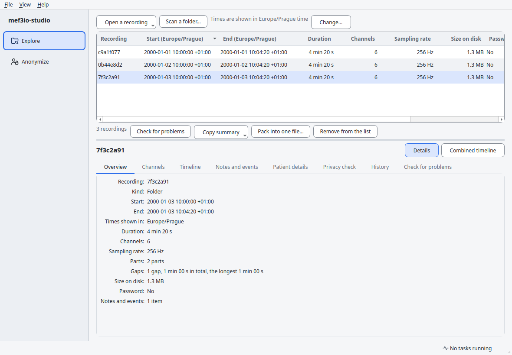
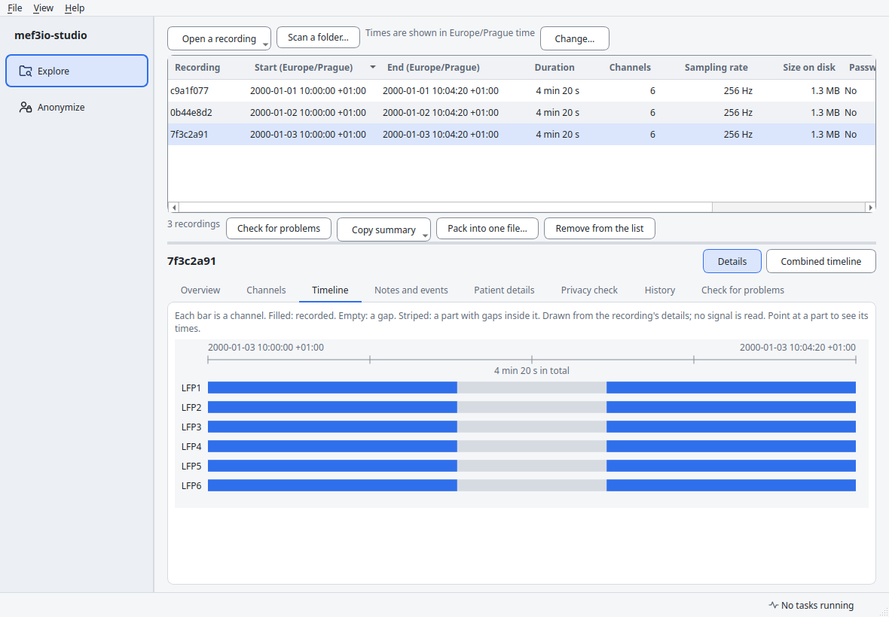
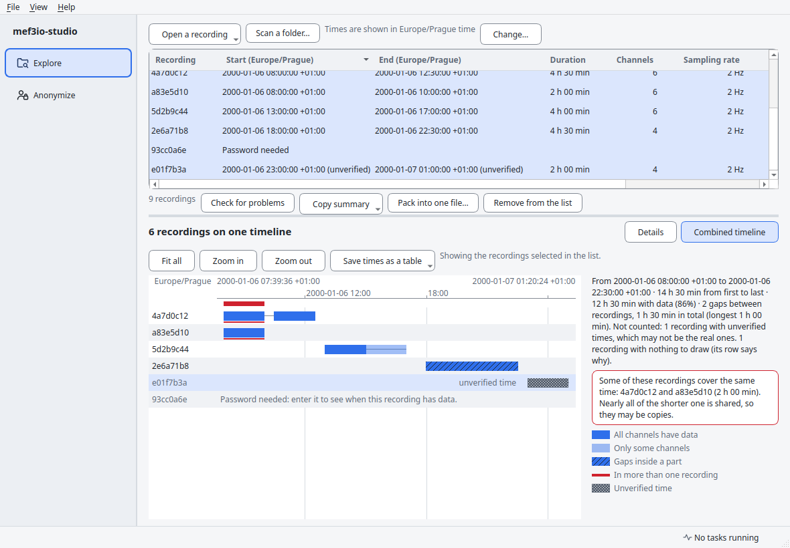
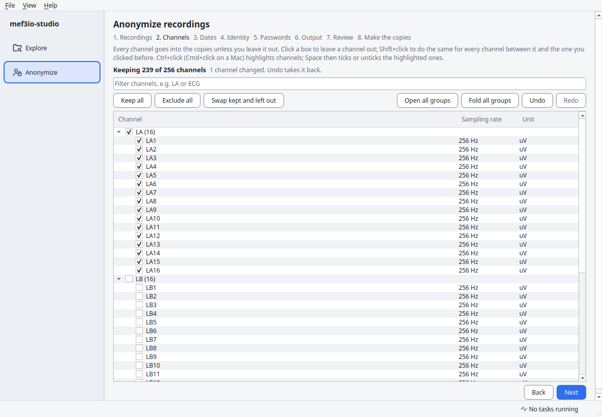
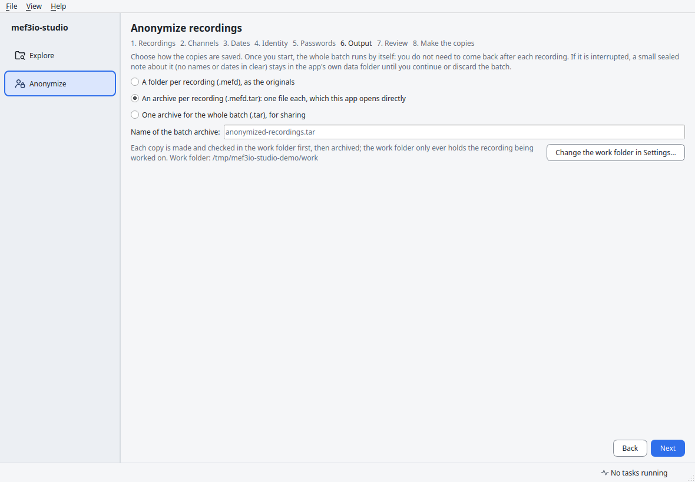
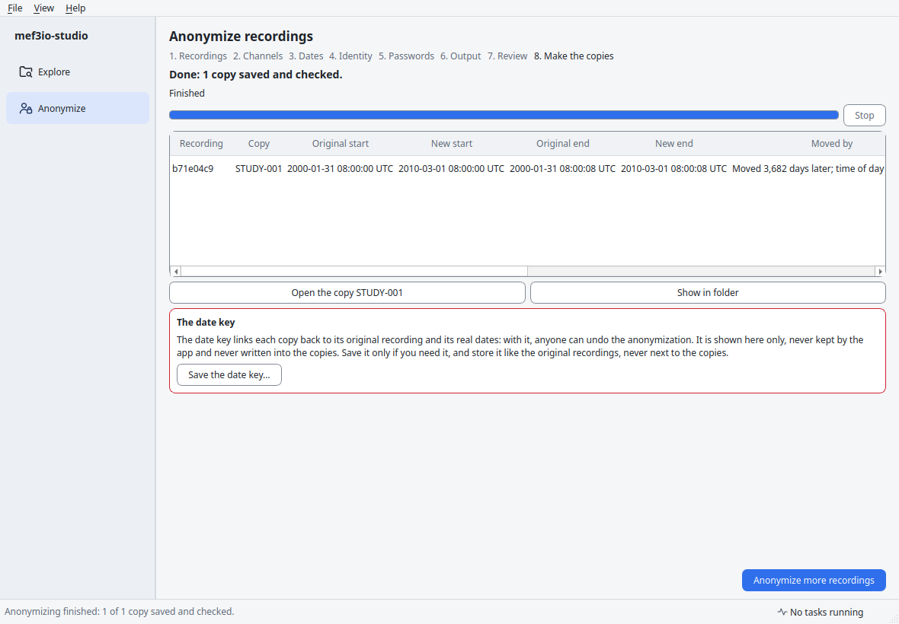
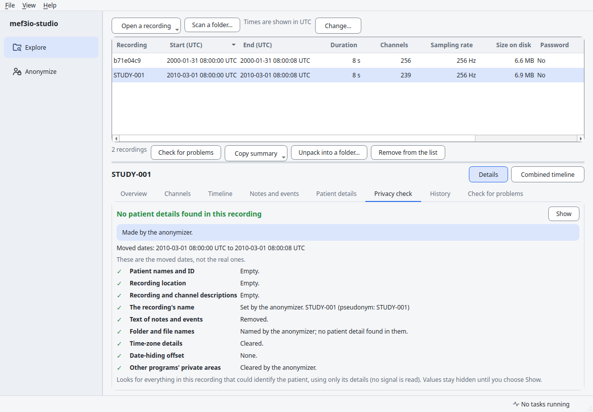

# User guide

## Explore recordings

The **Explore** page shows what is in your recordings: channels, when they
start and end, gaps, notes and events, and more. **Opening a recording never
changes it, and its signal is not loaded**, so even very large recordings
open quickly.

### Opening recordings

A recording is a folder ending in `.mefd`, or a single file ending in
`.mefd.tar`. There are three ways to open one:

- **Open a recording** (top left, or File → Open): pick a recording folder or
  a single-file recording.
- **Drag and drop** recordings onto the page. If you drop a folder that is not
  a recording, the app looks inside it for recordings.
- **Scan a folder**: finds every recording in a folder and all its subfolders.
  This is the quickest way to sort out a folder full of recordings with
  random-looking names.

Recordings open in the background. Each task appears in the Activity panel
with a progress bar and a **Stop task** button; the window stays usable. The
bar follows how much the app has actually read or copied, and **Stop task**
stops the work straight away, even in the middle of a large recording.
Stopping is never an error: the list says **Stopped**, and anything the task
had started to write is removed.

**Password-protected recordings** ask for their password when you open them
on their own. When they are found by a scan, the list says **Password needed**;
select the recording and choose **Enter the password…**.

- The **full-access password** opens everything, including the patient
  details.
- The **basic password** opens everything except the patient details.

Passwords are kept only while the app is open. They are never saved and never
written to the app's log. Note that MEF passwords don't hide the signal, the
recording's name or its timing.

Passwords with accented or other non-English letters (for example "é") are
now handled exactly the way other MEF programs handle them. A recording that
was protected by an older version of this app's software may open only with
the older rule. It still opens, and the Overview shows a short note: *"This
password works here because the recording was protected by an older version
of this app's software. Other programs may not accept this password for this
recording."* Nothing is wrong with the recording itself.

### The list of recordings

Each row shows the recording's name, start and end, duration, number of
channels, sampling rate, size on disk, whether it is password-protected, and
the result of the last check for problems.

- The list is **sorted by start time**. Click any column heading to sort by
  that column instead; click again to reverse the order.
- Select several rows with Ctrl (⌘ on a Mac) or Shift.
- **Remove from the list** only removes rows from the list. Nothing is
  deleted.
- Numbers (duration, channels, sampling rate, size) line up on the right
  under their headings; names and times on the left.

### Times and time zones

Recordings store every time in UTC, and the app shows UTC until you choose
the time zone of the place where the recordings were made: **View → Time
zone…** (or **Change…** at the top right). After that, every time is shown
in that place's local time, with its offset from UTC, correct on both sides
of a daylight-saving change. The choice is remembered.

Times marked **(unverified)** may not be the real ones. They are listed
after the others when you sort by time. This happens in three cases:

- the part of the recording that confirms the times is locked until the
  full-access password is given (with only the basic password, the times are
  worked out the way they are stored in almost every recording, but they
  can't be confirmed);
- different parts of the recording say different things about how their
  times are stored;
- the recording carries a **time offset** that older software used to hide the
  real date (also when only some of its parts carry one). The app shows a warning for these: *"This recording hides its real
  date in a way that can be undone; treat it as identifiable."* The real date
  is still in the file, so such a recording is **not** anonymized. Older
  programs stored such times in two different ways, and the file does not say
  which, so the times shown (as the mef3io library works them out) are
  unverified.

### The details of a recording

Select a recording to see its details in the tabs below the list:

| Tab | What it shows |
|---|---|
| **Overview** | Start, end, duration, channels, sampling rates, parts, gaps, size and password protection, plus any warnings (for example a part that could not be read) |
| **Channels** | Each channel's sampling rate, units, number of samples and parts, and first and last sample time |
| **Timeline** | Each channel as a bar over time. Filled: recorded. Empty: a gap. Striped: a part that has gaps inside it. Point at a part to see its times |
| **Notes and events** | Notes stored for the whole recording, with each channel, and with each part. Their text is hidden until you choose Show under Patient details. With only the basic password, their text reads *Locked: needs the full-access password* |
| **Patient details** | Name, patient ID, location and descriptions, **hidden until you choose Show** |
| **History** | Which version of the mef3io library created the files and last changed them, and what was done (for example "added to"). No dates are recorded. Files written by other programs have no history |
| **Check for problems** | Compares what the recording says about itself with its data. Choose **Check now**; the results are explained in plain words, with the technical details one click away. Checking never changes the recording |

**A recording with a damaged part still opens.** If one part of a channel
can't be read, the rest of the recording is shown, that part's time shows as
empty on its channel's timeline, and the Overview says how many parts could
not be read (the list
says *Some parts could not be read* until you run a check). Use **Check for
problems** to see why. Nothing is changed. Only when no part at all can be
read does the recording show *This recording looks damaged* instead.

### Several recordings on one timeline

Choose **Combined timeline** (next to **Details**, above the tabs) to see
several recordings together, **one row per recording**, on one shared time
line:

- **Which recordings:** the ones selected in the list when you select two or
  more (Ctrl or Shift); otherwise every recording in the list.
- **Rows are in time order.** Recordings whose times are unverified come
  after the others, and recordings with nothing to draw (still being read,
  locked, or not readable) come last, each with a line saying why.
- **What the bars mean:**
  - **dark:** every channel of the recording has data at that time;
  - **light:** only some of its channels do;
  - **striped:** a part with gaps inside it (where exactly is not known
    without reading more of the recording);
  - **a thin line** between bars: a gap inside the recording;
  - **red:** time that more than one recording covers (a band under the time
    scale, and a line under each recording concerned);
  - **grey and dotted, labelled "unverified time":** the times may not be the
    real ones (see *Times and time zones*). These are drawn so you can see
    them, but they are **not counted** in the figures and never flagged as
    overlapping;
  - **labelled "some parts unreadable":** parts of this recording could not
    be read. Their time is unknown, so it is **not counted** as time with
    data, and a gap in that row may be time that was recorded. The figures
    say how many recordings this concerns.
- **The figures beside it** are worked out across the recordings with
  verified times: first and last time, the time from first to last, the time
  with data, and the gaps between recordings.
- **Overlaps are flagged plainly.** Two recordings that cover the same time
  have been made at the same time (for example on two beds), or they may be
  copies of each other, for example a folder and its single-file copy. When nearly all
  of the shorter one is shared and the channels are the same, the warning
  says they may be copies. Where two recordings have the same name, the
  timeline shows their file names (with `.mefd` or `.mefd.tar`) to tell them
  apart. When very many recordings share time, they are counted but not
  listed in pairs.
- **Zoom and move:** turn the mouse wheel over the bars to zoom in or out
  around the pointer, drag to move along the time line, and use **Fit all**
  (or the Home key) to see everything again. Over the names, the mouse wheel
  scrolls through the rows when they don't all fit.
- **Point at a bar** to see the stretch's start, end and length, and how many
  of the recording's channels have data there. **Click a row** to select that
  recording in the list; **double-click** it to open its details.

Times are shown in the chosen time zone, with the offset, like everywhere
else. Like the rest of the page, the timeline is drawn from what the app has
already read: no signal is loaded. Patient details are not part of this view.

### Save times as a table

**Save times as a table** (on the combined timeline) writes the start and end
times of those recordings to a CSV file that opens in Excel, LibreOffice and
other spreadsheet programs. Right-click the list for **Save their times as a
table (CSV)…** to save just the selected recordings. Two layouts:

- **One row per recording** (the usual choice): name, file name, start, end,
  duration, channels, sampling rates, number of parts, time with data, gaps
  between parts, parts with gaps inside them, the number of parts that could
  not be read, and which other recordings in the table cover the same time,
  and for how long.
- **One row per part of each channel:** recording, channel, part number,
  start, end, duration, samples, sampling rate, and whether the part has gaps
  inside it. A part that could not be read gets its own row saying *could not
  be read*, with no times.

When a recording has parts that could not be read (the `unreadable_parts`
column), its gaps may include time that was recorded: treat them as
unknown, not as missing data.

Every start and end is written both for **people** and for **machines**:

- **Readable:** `2000-01-06 07:00:00` in UTC. Most spreadsheet programs
  recognise this as a date and time, so you can sort and calculate with it.
  (In LibreOffice, tick *Detect special numbers* when opening the file.
  Spreadsheets show fractions of a second only to the millisecond; use the
  microseconds column when you need more.) When you have chosen a site time
  zone, a second readable column gives the time on the site's clock (for
  example `2000-01-06 08:00:00`); the `site_time_zone` column says which
  zone. **Sort and calculate with the UTC column:** when the clocks go back
  in autumn, the site's clock repeats an hour, so two different times can
  read the same there. The column with the offset tells them apart.
- **The standard format that scripts read (ISO 8601):** `2000-01-06T07:00:00Z`
  in UTC, and with a site time zone also the site time with its offset
  (`2000-01-06T08:00:00+01:00`).
- **Seconds since 1970 (Unix time):** `947142000`, with decimals down to
  the microsecond when needed, as most programming languages and databases
  expect.
- **Microseconds since 1970 in UTC:** a whole number that converts back
  exactly in scripts.

Spreadsheet programs keep only 15 digits of a number, so they round the
last two columns when the time has a fraction of a second. Import those
columns as text if you need them exact. A time that is not valid (for
example from a damaged file) reads `not a valid time` in the readable and
standard columns; the two number columns keep the value exactly as stored.

Read the columns by their names, not their positions: newer versions of the
app may add columns.

The column names say which is which, for example `start_utc_readable`,
`start_utc`, `start_unix_seconds` and `start_microseconds_utc`.

- **Before saving, the app warns you:** *"This file will contain the dates of
  the recordings, which can identify people. Store it like the recordings
  themselves."*
- **Patient details** are included only for recordings where you chose
  **Show**; for the others the columns read `[hidden]`.
- **Unverified times** are marked in the `times_verified` and `time_note`
  columns and never counted as overlapping. Recordings that are locked or
  could not be opened get a row saying so, without times.
- The file is written under a temporary name and only takes its final name
  when it is complete; stopping the task leaves nothing behind. The save
  dialog asks before replacing a file.
- Text cells that a spreadsheet would treat as a formula (starting with `=`,
  `+`, `-` or `@`, for example a strange file name) get a `'` in front, so
  opening the table never runs anything.

### Patient details stay hidden

Patient details, descriptions and the text of notes are hidden until you
choose **Show** on the Patient details tab. That choice applies to that one
recording, only until you close the app. Patient details never go into the
app's log.

### Copy summary

**Copy summary** copies a short description of the selected recordings, as
plain text or as JSON (for scripts and data-management logs). Names and
dates are replaced by `[hidden]` unless you chose Show for that recording; in
that case the app warns you before copying.

### Pack into one file, or unpack

**Pack into one file…** turns a recording folder into a single `.mefd.tar`
file, which is easier to copy and send. **Unpack into a folder…** does the
opposite. You choose where the new copy goes:

- the original is never changed;
- nothing that already exists is ever replaced: if the name is taken, the app
  says so and writes nothing;
- the new copy is checked against the original before it gets its final
  name, and it is added to the list.

If you stop the task, the unfinished copy is removed.

## Anonymize recordings

The **Anonymize** page makes **anonymized copies** of recordings: the patient
details are removed and every date and time is moved by the same amount. The
originals are never changed. A wizard takes you through it step by step, with
**Back** and **Next**; **nothing is written until the last step**.

1. **Recordings.** Tick the recordings to anonymize. They come from the list
   in Explore (open or scan for more here). A recording that cannot be
   anonymized says why, and cannot be ticked: for example, a
   password-protected recording opened only with its basic password (open it
   again with the full-access password), or one whose parts disagree about
   its dates.
2. **Channels.** Every channel is kept unless you leave it out.
   - Click a box to leave a channel out. **Shift+click** another box to do
     the same for every channel in between that is on screen (channels in a
     folded group or hidden by the filter are never touched). After every
     change the step says how many channels changed. **Ctrl+click** (Cmd+click on a
     Mac) highlights channels; **Space** then ticks or unticks them all.
   - Channels are **grouped by electrode** (`LA1 … LA16`; labels such as
     `EEG LA1-Ref` and pairs such as `LAH1-LAH2` are grouped by their
     electrode too); a group's box ticks or unticks the whole electrode, and
     shows a dash when only some of it is kept. Long lists start folded.
   - Type in the **filter** to narrow the list; **Exclude N shown** and
     **Keep N shown** act on exactly what the filter shows, and so does a
     group's box while the filter is on.
   - **Keep all**, **Exclude all** and **Swap kept and left out** act on
     every channel;
     **Undo** and **Redo** (Ctrl+Z, Ctrl+Shift+Z) take back any change.
   - **"Keeping N of M channels"** is always shown; you cannot continue with
     no channel kept.
   - With several recordings, the choice is made **by channel name** and
     applies to all of them. A name that is not in every recording is marked
     ⚠ and listed below the list. If you go back and change which recordings
     are chosen, the channels you left out stay left out by name, and the
     step says so (Undo starts again from there).
3. **Dates.** Choose how the dates move:
   - **one shift for all** (keeps the order and spacing of the recordings),
     or **every copy starts at the same moment**;
   - keep the **local** time of day (needs the time zone where the
     recordings were made), keep the **UTC** time of day, or change the time
     of day too;
   - the **new date** of the **reference recording** (by default the
     earliest one): the reference gets exactly that date, and the others
     follow it (by the same shift, or starting at the same moment), and
     optionally **keep the day of the week**.

   The preview shows each recording's original start and its new start and
   end, and warns about daylight-saving changes and recordings made in the
   other season. The dates must move by at least the time the recordings
   span plus one day; otherwise a moved date could be mistaken for a real one.
4. **Identity.** Give each copy a **name** (it becomes the folder name and is
   stored in every file) and a **pseudonym** (stored as the patient's code).
   Neither may contain the patient's name, ID or location, or the original
   recording's name: when you press Next, the app asks the mef3io library to
   check them, and a refused name is shown on this step. Choose which
   details to clear (all, by default) and what happens to the **text of notes
   and events**: **remove** it (the default; the notes and their moved times
   stay) or **keep** it. Kept text has the patient's known details taken out,
   but dates and other people's names in free text are **not** found: read it
   yourself before sharing.
5. **Passwords.** No password (the usual choice for sharing), or two new
   passwords: a **basic** one and a **full-access** one. Passwords lock the
   patient details and the text of notes; they do not hide the signal, the
   recording's name or its timing. The original's passwords are never carried
   over, and the app never stores passwords. The app warns when other
   programs may not accept a password (more than 15 characters, or
   characters beyond the Latin alphabets). The typed passwords are cleared
   if you leave the page before the copies are made; you then type them
   again.
6. **Output.** Choose how the copies are saved: a **folder per recording**
   (`.mefd`, like the originals), an **archive per recording** (one
   `.mefd.tar` file each, which this app opens directly), or **one archive
   for the whole batch** (see below).
7. **Review.** Choose where to save the copies, then check, for every
   recording: the channels kept and the ones left out (by name), the original
   and new start and end, how far the dates move, where the copy goes, its
   estimated size and the free space. The app refuses to start if a name is
   taken or the folder is inside any recording.
8. **Make the copies.** First the app checks everything it can before
   starting (the names, that the originals are still there, that nothing
   is in the way, and that there is enough free space), so a long batch
   does not fail after hours. Then each copy is made and **checked** in the background,
   with a progress bar and **Stop**. A stopped or failed copy leaves nothing
   behind, and the others still go ahead; if an unfinished copy could not be
   removed, the result says so and names the folder to delete. Each recording
   then says **Saved and checked**, or why it was not saved.

### Anonymize a batch into archives

Anonymizing many recordings can take hours. You can start a batch and walk
away: the app does every recording, one after another, without asking
anything.

For each recording, when you chose archives:

1. it makes the anonymized copy in the **work folder** and checks it;
2. it packs that copy into an archive in the chosen folder, under a
   temporary name;
3. it opens the archive and checks that it matches the checked copy (the
   same channels, parts, times and number of samples, and every byte of
   every file), then gives it its final name;
4. only then does it delete the copy from the work folder.

The work folder only ever holds the recording being worked on.

**One archive for the whole batch** is a single `.tar` file for sharing.
Inside it, each anonymized recording is its own folder. This app and the
mef3io library cannot open that file directly: extract it first with any
archive tool (7-Zip, the one built into Windows or macOS, or `tar`), which
gives back the recordings, ready to use. It does **not** join the
recordings into one recording; they stay separate.

While a batch runs:

- **one problem does not stop the batch:** a recording that cannot be copied
  is reported, and the others go ahead. If the recordings or the destination
  cannot be reached (a network drive that went away), the recording is kept
  for a retry; after three in a row the batch pauses and offers **Retry the
  failed ones**;
- **Stop** ends the step that is running and removes anything half-made. With
  one archive for the batch, the unfinished archive is kept so the batch can
  be continued, or you choose **Finish the archive with what is done**: it is
  then named and reported as partial ("3 of the 7 recordings; 4 are not in
  it"). Until the archive is finished, its recordings say **Added to the
  batch archive**;
- **the computer is kept awake** until the batch ends (you can turn this off
  in Settings);
- the progress shows how many recordings are done ("Recording 3 of 7"), the
  current step ("Anonymizing", "Making the archive", "Checking the archive",
  "Adding to the bundle") and the time left, and a notification tells you
  when the batch is done.

**If the batch is interrupted** (the app was closed, the computer crashed or
lost power), the next start asks: "Continue the batch: 4 of 7 done".
Until you continue or discard it, a small sealed note about the batch (no
names or dates in clear) stays in the app's own data folder. Continuing
checks everything again, then makes the rest. Passwords are never stored,
so you type them again: each original's, and the copies' two new passwords
twice; each is tried before anything is made. If a result is already there
for a recording that was being made when the batch stopped, you choose to
keep it (marked as not confirmed) or make it again. Unfinished copies and
archives left behind are never kept silently: the app offers to remove them
("They should hold no patient details, but they were never checked: do not
use or share them").

### Settings

**File → Settings** (on a Mac: mef3io-studio → Settings):

- **Work folder:** where each copy is made and checked before it is
  archived. By default it is a folder in the app's own data area. A fast
  local disk is a good choice when your recordings are on a network drive.
  The app checks that it can write there and that it is not inside a
  recording, and before every batch that it has room for the largest
  recording.
- **Keep the computer awake while a batch runs:** on by default.

The app remembers these between sessions. The work folder is stored in a
sealed form, never as plain text in the app's settings.

### The result and the date key

The result lists, for every recording, its **original and new start and
end** and how far the dates moved ("Moved 3,712 days later; time of day
(UTC) kept"). **Open the copy** shows it in Explore, straight on its
**Privacy check**.

This list is the **date key**: with it, anyone can undo the anonymization.
The app shows it here only. **Save the date key…** writes it to a separate
file, only if you ask, after a warning: store that file like the original
recordings, never next to the copies (the app refuses a place inside the
copies' folder or a recording, and on macOS and Linux only your account can
read the file). The key is never written into the
copies, the app's log or its settings.

### Privacy check

The **Privacy check** tab in Explore works on any recording, original or
copy. The first line says, in green, **No patient details found in this
recording**, or in red, **Found N details that may identify the patient**,
with each one listed (values stay hidden until **Show**). When some details
could not be read (for example a password-protected recording opened with
the basic password), it never says green: it says **Some details could not
be checked: open it with the full-access password**. Below it, one line
per kind of detail, each marked ✓ (empty) or ✗ (holds something): patient
names and ID, the recording location, the descriptions, the recording's name
(for a copy, its pseudonym), the text of notes and events, folder and file
names, the time-zone details, the date-hiding offset some older tools use,
and other programs' private areas in the files. A dash (–) means the app
cannot tell from here: it needs the full-access password, or it can only be
confirmed for copies the anonymizer made. On original recordings the
descriptions are often marked ✗: files written by some programs (mef3io
among them) store the recording's and channels' names in their
descriptions.

When every part of the recording was **made by the anonymizer**, and
nothing was done to it afterwards, the card says so, and its start and end
are labelled as the **moved dates**. A copy that was changed afterwards (for
example, data was added) says that its dates can no longer be confirmed. For any
other recording it says: "This recording wasn't made by the anonymizer, so we
can't confirm its dates were moved." The check reads nothing but the
recording's details, so it is instant even on very large recordings.
